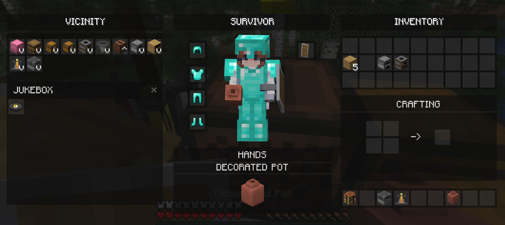

# DayZ Inventory

**English** · [中文](README.zh.md) · [Français](README.fr.md) · [日本語](README.ja.md) · [한국어](README.ko.md)

[](https://modrinth.com/mod/dayz-inventory)
[](https://www.curseforge.com/minecraft/mc-mods/dayz-inventory)
[](https://modrinth.com/mod/dayz-inventory/versions)
[](https://modrinth.com/mod/dayz-inventory)
[](https://www.curseforge.com/minecraft/mc-mods/dayz-inventory)
[](LICENSE)
[](https://ko-fi.com/suoim)

A complete overhaul of the Minecraft inventory UI, bringing the look, feel, and mechanics of the
DayZ inventory system into Minecraft: a **Vicinity** grid of nearby ground items and containers, a
dynamic **Hands** slot bound to the active hotbar slot, the **Survivor** panel with your gear, status
effects and vitals, and an integrated **2x2 crafting grid**.

**Really recommended with [DayZ Hotbar](https://modrinth.com/mod/dayz-hotbar)** — seamless
integration. The two are built as a pair, so the HUD and the inventory screen share one look.

## Supported versions

| Loader | Minecraft |
| :--- | :--- |
| **Fabric** | 1.20.1 – 26.3 |
| **NeoForge** | 1.20.6 – 26.3 |
| **Forge** | 1.20.1, 1.20.6 – 1.21.11 |

**23 Minecraft versions, 54 downloads**, all from one source tree. Each file is labelled with its
Minecraft version and its loader; the [full table](#full-version-table) lists every version.



---

## Features

### Vicinity
- **Ground items and containers in one grid**: everything within 3 blocks (configurable) — dropped
  items, chests, barrels, shulker boxes and any other block with an inventory — with the nearest
  container first, rescanned every half second.
- **Pick up by hand**: walk-over pickup is off. Drag an item into a slot, drop it on the Survivor
  panel to equip it, or shift-click it to take it.
- **Inline drawers**: click a container to open its slots right below the grid, sort it, and close it
  with the `x`. Locks, blocked chest lids and loot tables work exactly as when you right-click the
  block.

### Survivor
- **Gear**: armour and offhand slots, with drag-to-equip onto the panel.
- **Status effects**: icons with name, level and time left on hover; they blink in their last ten
  seconds.
- **Vitals**: health, food and thirst bars. Thirst shows when **Tough As Nails**, **Thirst Was
  Taken** or **Dehydration** is installed.
- **Hands**: the held item at 2x, with its name, bound to the selected hotbar slot.

### Inventory
- **Sort**: merges partial stacks and sorts the main inventory; the hotbar stays as it is.
- **Shift-click** moves items between the main inventory and the hotbar, into an open container, or
  onto your body.
- **2x2 crafting**, computed on the server like vanilla's.

### Works with
- **JEI, REI, EMI**: a button that shows or hides the recipe viewer's item list.
- **Curios, Accessories, Trinkets**: a button for each one installed, on the Survivor panel.
- **Mouse Tweaks**: drags and scroll-wheel moves work in the DayZ screen too.

None of these are required: every integration is detected at runtime, and the mod works fully
without any of them.

### Languages
English, 中文, Français, 日本語, 한국어.

---

## Installation

1. Find your Minecraft version and loader in the [table below](#full-version-table).
2. Download the file whose name matches **both** from
   [Modrinth](https://modrinth.com/mod/dayz-inventory/versions) or
   [CurseForge](https://www.curseforge.com/minecraft/mc-mods/dayz-inventory/files).
3. Drop it into `mods/`. On Fabric, also install [Fabric API](https://modrinth.com/mod/fabric-api).

Install it on **both the server and every client**: the inventory screen, item pickup and container
opening all run partly on the server.

> **Pick carefully.** A Fabric build will not load on Forge or NeoForge, a NeoForge build will not
> load on Forge, and builds for different Minecraft versions are not interchangeable.

## Configuration

`config/dayz_inventory.properties` is created on first launch. Changes apply on the next start.

| Option | Default | |
| :--- | :--- | :--- |
| `autoPickup` | `false` | Walk-over item pickup, as in vanilla. Creative players always have it. |
| `openContainersInDayZScreen` | `true` | Right-clicking a chest or barrel opens it in the DayZ screen. |
| `vicinityRadius` | `3` | How far the Vicinity panel reaches, 1 to 8 blocks. Use the same value on the server and its clients. |
| `replaceInventoryScreen` | `true` | The inventory key opens the DayZ screen. |
| `showStatusEffects` | `true` | Status effect icons on the Survivor panel. |
| `showVitals` | `true` | Health, food and thirst bars on the Survivor panel. |
| `dragAndDrop` | `true` | Press on an item and release it over another slot to move it. Off while Mouse Tweaks is installed. |

On a dedicated server the gameplay options (`autoPickup`, `openContainersInDayZScreen`,
`vicinityRadius`) come from the server's file; in singleplayer your own file is used.

---

## Full version table

| Minecraft | Fabric | NeoForge (min.) | Forge (min.) | Java |
| :--- | :---: | :---: | :---: | :---: |
| **1.20.1** | ✅ | — | ✅ any 47.x | 17 |
| **1.20.2** | ✅ | — | — | 17 |
| **1.20.3** | ✅ | — | — | 17 |
| **1.20.4** | ✅ | — | — | 17 |
| **1.20.5** | ✅ | — | — | 21 |
| **1.20.6** | ✅ | ✅ 20.6.141+ | ✅ 50.2.10+ | 21 |
| **1.21** | ✅ | ✅ 21.0.167+ | ✅ 51.0.33+ | 21 |
| **1.21.1** | ✅ | ✅ 21.1.250+ | ✅ 52.1.12+ | 21 |
| **1.21.2** | ✅ | ✅ 21.2.1-beta+ | — | 21 |
| **1.21.3** | ✅ | ✅ 21.3.97+ | ✅ 53.1.12+ | 21 |
| **1.21.4** | ✅ | ✅ 21.4.157+ | ✅ 54.1.18+ | 21 |
| **1.21.5** | ✅ | ✅ 21.5.98+ | ✅ 55.1.13+ | 21 |
| **1.21.6** | ✅ | ✅ 21.6.20-beta+ | ✅ 56.0.9+ | 21 |
| **1.21.7** | ✅ | ✅ 21.7.25-beta+ | ✅ 57.0.3+ | 21 |
| **1.21.8** | ✅ | ✅ 21.8.54+ | ✅ 58.1.22+ | 21 |
| **1.21.9** | ✅ | ✅ 21.9.16-beta+ | ✅ 59.0.5+ | 21 |
| **1.21.10** | ✅ | ✅ 21.10.64+ | ✅ 60.1.15+ | 21 |
| **1.21.11** | ✅ | ✅ 21.11.45+ | ✅ 61.2.1+ | 21 |
| **26.1** | ✅ | ✅ 26.1.0.19-beta+ | — | 25 |
| **26.1.1** | ✅ | ✅ 26.1.1.15-beta+ | — | 25 |
| **26.1.2** | ✅ | ✅ 26.1.2.109+ | — | 25 |
| **26.2** | ✅ | ✅ 26.2.0.88+ | — | 25 |
| **26.3** | ✅ | ✅ 26.3.0.1-beta+ | — | 25 |

**Fabric** also needs [Fabric API](https://modrinth.com/mod/fabric-api) for your Minecraft version
and Fabric Loader 0.15 or newer.

Why some cells are empty:

- **NeoForge 1.20.1 – 1.20.5**: 1.20.1 predates NeoForge, and its 1.20.2 – 1.20.5 releases use APIs
  this mod does not carry.
- **Forge 1.20.2 – 1.20.5**: rarely played on Forge, and Forge never released 1.20.5.
- **Forge 1.21.2**: Forge skipped that release.
- **Forge 26.x**: NeoForge is the supported route there.

---

## Building from source

The Gradle launcher needs **JDK 25**; the Java 17 / 21 toolchains the older versions use are
downloaded automatically.

```bash
# Every Minecraft version and loader.
./gradlew chiseledBuild

# One Minecraft version, all of its loaders (what CI does per job).
./gradlew buildMods -Pdayz.versions=1.21.1

# One target. Jars land in <loader>/versions/<mc>/build/libs/.
./gradlew :fabric:26.2:build
./gradlew :forge:1.20.1:build
```

Jars are named `dayz-inventory-<loader>-<minecraft>-<version>.jar`, for example
`dayz-inventory-forge-1.20.1-2.0.0+mc1.20.1.jar`.

How the build works — the version matrix, the three loader toolchains, conditional compilation,
adding a Minecraft version, CI and publishing — is in **[docs/BUILDING.md](docs/BUILDING.md)**.

Releases are published by CI: pushing a `v<version>` tag builds every version, attaches the jars to
the GitHub release and uploads them to Modrinth and CurseForge. Pull requests only build.

## License

Apache License 2.0 — see [LICENSE](LICENSE).
